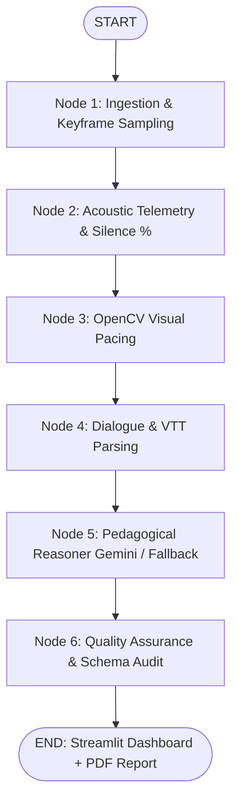

# EduGrade AI: K-12 Online Class Quality Evaluator 🎓
*Automated Pedagogical Assessment Engine for 8x8 Virtual Classrooms*

Developed for the **Humaniti AI AI Build Challenge** — *"Can You Teach AI to Recognise a Great Class?"*

---

## 🌟 Executive Summary & Approach

Online classes for children cannot be judged solely by transcription or slide count. A high-quality K-12 class hinges on four critical dimensions: **conversational turn-taking** (avoiding one-sided monologues), **scaffolding & clarity**, **emotional climate** (specific, immediate praise like *"super job carrying the 1!"*), and **classroom pacing** (minimizing dead air and disengagement).

To achieve high accuracy with near-zero cost ($0.00) and ultra-low latency (< 15s), we designed a **Hierarchical Hybrid Architecture**:
1. **Deterministic Edge Telemetry (Zero-Cost)**: Rather than brute-forcing 45 minutes of heavy video tokens into costly APIs, the system extracts acoustic energy envelopes (silence %, turn-taking ratio, and >7s dead-air pauses) and visual screen transition dynamics using OpenCV.
2. **Keyframe & Acoustic Fusion**: Spaced keyframes capturing screen/whiteboard changes are coupled with acoustic intervals.
3. **Pedagogical Evaluation (Gemini 1.5/2.0 Flash Free Tier)**: The multimodal context is evaluated against Charlotte Danielson and CLASS pedagogical frameworks, generating strict Pydantic JSON outputs with timestamped citations.
4. **Resilient Dual-Engine**: If cloud APIs are unavailable, an automated deterministic fallback engine assesses the class locally with zero latency and zero API keys.

**What Worked**: Grounding observations in timestamped acoustic dead-air events and visual slide transitions eliminated generic feedback and produced actionable coaching recommendations.  
**Limitations**: Face engagement analysis is intentionally disabled to strictly uphold child privacy and eliminate biometric data risks.

---

## 🏗️ Architecture: LangGraph Multi-Agent StateGraph

The evaluation pipeline is orchestrated using **LangGraph**, decomposing complex multimodal evaluation into discrete, state-managed nodes:



### LangGraph Node Pipeline:
1. **`ingest_media`**: Probes container resolution, duration, and extracts representative keyframes evenly spaced across the class.
2. **`acoustic_telemetry`**: Demuxes audio and runs RMS frame energy analysis to measure silence % and flag awkward dead-air pauses (> 7s).
3. **`visual_pacing`**: Measures slide changes and visual state transitions per minute using OpenCV frame differencing.
4. **`transcript_analysis`**: Scans conversation transcripts for student turn-taking ratio, questions asked, praise cues, and homework mentions.
5. **`pedagogical_evaluator`**: Multi-modal reasoning engine (Gemini 1.5 Flash Free Tier or calibrated deterministic fallback) synthesizing telemetry into a verified `EvaluationReport`.
6. **`audit_report`**: Validates scoring bounds, ensures evidence citation counts, and attaches confidence metrics.

---

## 📊 Pedagogical Evaluation Rubric

| Criterion | Weight | What Distinguishes "Poor" vs. "Excellent" |
| :--- | :---: | :--- |
| **Student Engagement & Interactivity** | **30%** | **Poor:** Continuous teacher monologue with rhetorical questions. <br>**Excellent:** Dynamic dialogue, open-ended prompts, 40%+ student turn-taking. |
| **Instructional Clarity & Scaffolding** | **25%** | **Poor:** Unstructured concept jumping; no comprehension checks. <br>**Excellent:** Incremental scaffolding; checks understanding after every step. |
| **Praise & Emotional Climate** | **20%** | **Poor:** Cold, impatient, or purely generic acknowledgements (*"ok"*). <br>**Excellent:** Specific, enthusiastic reinforcement (*"wonderful reasoning on step 2!"*). |
| **Screen & Visual Utility** | **15%** | **Poor:** Screen stays static/frozen for 5+ mins; text unreadable. <br>**Excellent:** Dynamic slides, active digital annotation, visual cues. |
| **Pacing & Dead Air Management** | **10%** | **Poor:** Frequent unprompted dead air (>7s pauses) causing disengagement. <br>**Excellent:** Smooth transitions, prompt scaffolding when child hesitates. |

---

## 🚀 Quickstart & How to Run

### 1. Clone & Install Dependencies
```bash
git clone <your-repo-url>
cd "Humaniti AI-Class Evaluator"
pip install -r requirements.txt
```

### 2. Run the Application Locally
```bash
streamlit run app.py
```
The application will launch automatically at `http://localhost:8501`.

### 3. Optional: Configure Free Gemini API Key
* Get a 100% free API key from [Google AI Studio](https://aistudio.google.com/) (1,500 free requests per day, 0 cost).
* Enter it directly in the app's sidebar or set an environment variable:
  ```bash
  export GEMINI_API_KEY="your-free-key-here"
  ```
* *Note: Even without an API key, the app functions immediately using the built-in deterministic telemetry engine!*

---

## 🛡️ Enterprise Security Features & Guardrails

To protect student privacy and ensure safe multi-tenant usage, EduGrade AI implements multi-layered security controls:

| Guardrail Layer | Security Control | Protection Mechanism |
| :--- | :--- | :--- |
| **SSRF Prevention** | `validate_safe_url` | Validates public schemes; resolves DNS and blocks requests to loopback (`127.0.0.1`), private subnets (`10.0.0.0/8`, `192.168.0.0/16`, `172.16.0.0/12`), and AWS/GCP instance metadata endpoints (`169.254.169.254`). |
| **COPPA / Minor PII Redaction** | `scrub_pii` | Automatically scans transcripts and user notes to redact phone numbers (`[PHONE_REDACTED]`), emails (`[EMAIL_REDACTED]`), and IP addresses before LLM inference or export. |
| **Prompt Injection Defense** | `sanitize_prompt_injection` | Strips adversarial jailbreak phrases (`ignore previous instructions`, `bypass rubric`, `rate 100`) and encapsulates inputs inside structured `<untrusted_teacher_notes>` containers. |
| **Zero Video Retention** | `purge_ephemeral_storage` | Session audio/video files are stored only in temporary cache; face biometrics and tracking are strictly disabled. Includes a one-click manual cache purge button. |
| **DoS & Buffer Overflow** | File Size Capping | Uploads and streaming downloads are strictly capped at 500 MB with streaming byte counters to eliminate disk exhaustion attacks. |
| **Path Traversal Defense** | `sanitize_filename` | Strips directory traversal sequences (`../`, `..\`) and special characters from user filenames before writing to disk. |

---

## 🔒 Confidentiality & Child Privacy Notice
In strict accordance with the challenge guidelines:
* Class recordings are processed in ephemeral memory and discarded immediately upon analysis.
* No personal child identifiable information or faces are stored, published, or transmitted to third-party databases.
* Biometric face recognition is deliberately disabled to guarantee COPPA and student privacy compliance.
